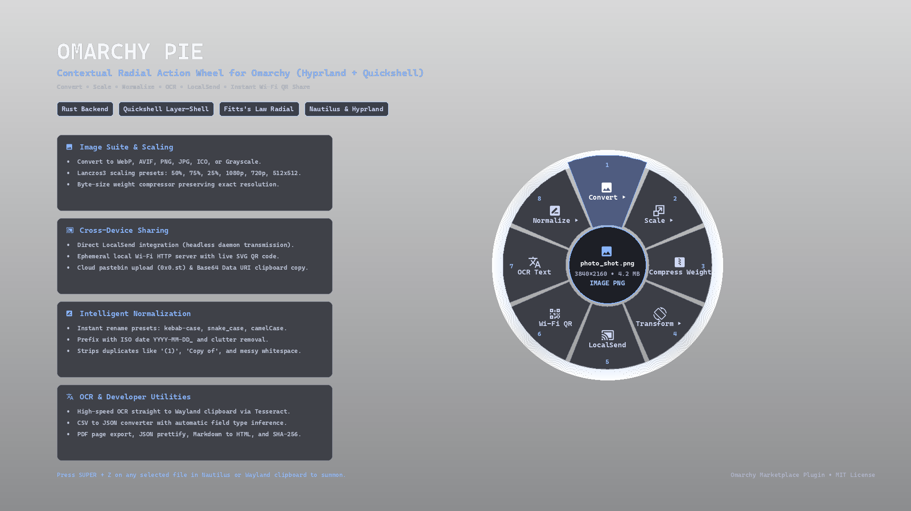

# Omarchy Pie

Context-aware radial action wheel for files and clipboard in [Omarchy](https://omarchy.org/) (Hyprland + Quickshell), powered by a native Rust backend.

**Omarchy Pie** is a high-performance productivity tool inspired by macOS radial action utilities. Select any file in your file manager (**Nautilus**, Dolphin, Thunar, etc.) or copy a screenshot to your clipboard, press **`SUPER + Z`**, and a smooth, circular pie menu appears instantly centered right around your cursor. The wheel intelligently adapts its slices and sub-menus to the selected file's format—letting you convert, resize, optimize, normalize filenames, run OCR, extract colors, or transfer across devices in a fraction of a second.

[](CHANGELOG.md)
[](LICENSE)
[](https://omarchy.org)
[](https://www.rust-lang.org)



---

## ✨ Features

### 🎯 100% Context & File-Type Aware
Unlike generic static application launchers, **Omarchy Pie** inspects the file extension, magic bytes, and MIME profile to build a custom radial wheel specifically designed for what you can do with that file:

- 🖼️ **Image Suite (`.png`, `.jpg`, `.jpeg`, `.webp`, `.avif`, `.gif`, `.bmp`)**:
  - **Convert ▸**: Direct conversion to WebP, PNG, JPG, AVIF, Grayscale, or multi-resolution `.ICO` Favicon.
  - **Scale ▸**: Quick resizing presets (`50%`, `75%`, `25%`, `1080p Full HD`, `720p HD`, and `512×512 Square Avatar`) using Lanczos3 filtering.
  - **Compress Weight**: Drastically reduces file size in MB/KB while preserving original image dimensions.
  - **Transform ▸**: Rotate 90° CW/CCW, Rotate 180°, Flip Horizontal, **Extract 5 Dominant HEX Colors** to clipboard, and **Strip EXIF / GPS Metadata**.
  - **OCR Text**: Extracts on-screen text from photos and screenshots straight to your Wayland clipboard via Tesseract.

- 📡 **Instant Sharing & Cross-Device Transfer (`Share ▸`)**:
  - **LocalSend**: Headless 1-click device transmission using `localsend --headless send` with automatic GUI fallback.
  - **Wi-Fi QR Server**: Rust spins up an ephemeral local HTTP server and renders a scannable SVG QR code directly inside the center hub of the radial menu. Anyone on your local Wi-Fi can scan and download the file immediately.
  - **Cloud Pastebin (`0x0.st`)**: 1-click temporary hosting upload, copying the public link and rendering a scannable QR code.
  - **Base64 / Data URI**: Instant encoding to `data:<mime>;base64,...` formatted strings for developers.

- 🏷️ **Intelligent Filename Normalizer (`Normalize ▸`)**:
  - `kebab-case`: `my-document-final.png`
  - `snake_case`: `my_document_final.png`
  - `camelCase`: `myDocumentFinal.png`
  - `ISO Date Prefix`: `2026-10-20_my-document.png`
  - `Clean Clutter`: Cleans out annoying suffixes (`(1)`, `Copy of`, `_final`, redundant spaces).

- 🎬 **Video & Audio Studio (`.mp4`, `.mkv`, `.mov`, `.webm`, `.mp3`, `.wav`, `.flac`, `.opus`)**:
  - **Video to Palette GIF**: Generates high-framerate, color-optimized GIF animations via `ffmpeg` color palettes.
  - **Extract MP3**: High-quality 192kbps audio extraction with clean metadata preservation.
  - **Compress Video**: Compresses large videos (<720p, CRF 28) for easy messaging uploads.
  - **Mute Audio**: Strips audio streams losslessly.
  - **Capture Snapshot**: Grabs the first keyframe as a crisp PNG image.
  - **Loudness Normalization**: EBU R128 broadcasting loudness leveling (`loudnorm`) for podcasts and music.
  - **Format Transcoding**: Fast conversion between MP4, WebM, Opus, and lossless FLAC.

- 📊 **Data, Documents & Developer Tools (`.csv`, `.json`, `.md`, `.pdf`, `.sh`, `.py`, `.rs`, `.blend`)**:
  - **CSV to JSON**: Automatic type-inferring converter with row and column count statistics.
  - **JSON Prettifier & Minifier**: Format or compress JSON files in place.
  - **Markdown to Styled HTML**: Compiles Markdown into modern, readable HTML with dark-mode typography.
  - **PDF to PNG**: Extracts every page of a document into crisp PNG image files.
  - **Script Runner & Permissions**: 1-click `chmod +x` toggle and instant execution in your favorite terminal emulator.
  - **Quick Launchers**: Open files in Neovim, VSCode, or Blender.
  - **Archive Manager**: Unpack or list `.zip`, `.tar.gz`, and `.tar.zst` packages.
  - **SHA-256 Checksum**: Calculates cryptographic checksum and copies it straight to the clipboard.

- 🗂️ **Directories & Fallback Modes**:
  - Open terminal directly in the folder, create `.tar.zst` or `.zip` archives, measure disk usage (`du -sh`), and clean trash files.
  - Seamless fallback to the latest screenshot or active clipboard file if nothing is actively selected.

---

## 📋 Requirements

### Core Dependencies
1. **Omarchy Linux** (v4+) with the Quickshell-based shell.
2. **Hyprland** Wayland Compositor.
3. **Rust & Cargo** (only if compiling from source; prebuilt binary is included).

### Recommended CLI Tools
For maximum functionality across all file types, ensure these common tools are available on your system:

| Tool | Purpose | Install (Arch / Omarchy) |
| :--- | :--- | :--- |
| **`ffmpeg`** | Video & audio conversion, GIF rendering | `sudo pacman -S ffmpeg` |
| **`imagemagick`** | Image conversions, ICO creation, rotation | `sudo pacman -S imagemagick` |
| **`tesseract`** | Optical Character Recognition (OCR) | `sudo pacman -S tesseract tesseract-data-eng` |
| **`localsend`** | Wireless peer-to-peer file transfer | `yay -S localsend-bin` |
| **`wl-clipboard`** | Wayland clipboard integration | `sudo pacman -S wl-clipboard` |
| **`qrencode`** | QR Code generation | `sudo pacman -S qrencode` |
| **`poppler`** | PDF rendering (`pdftoppm`) | `sudo pacman -S poppler` |

---

## 🚀 Installation

### Via Omarchy Plugin CLI

```bash
# Add the plugin from GitHub and enable it
omarchy plugin add https://github.com/JeffCortez23/omarchy-pie.git --enable
```

When enabled, the plugin's `Service.qml` automatically:
1. Symlinks the executable to `~/.local/bin/omarchy-pie`.
2. Installs the **Nautilus** context script to `~/.local/share/nautilus/scripts/Omarchy Pie`.

---

## ⌨️ Hyprland Keybinding Setup

To summon the radial menu whenever you press **`SUPER + Z`**, add the following binding to your `~/.config/hypr/bindings.lua`:

```lua
local paths = require("default.hypr.paths")

o.bind("SUPER + Z", "Omarchy Pie (Radial Action Wheel)", function()
  local win = hl.get_active_window()
  local class = win and (win.class or ""):lower() or ""
  
  -- If Nautilus or any file manager is active, copy selected file cleanly
  if class:find("nautilus") or class:find("thunar") or class:find("dolphin") or class:find("nemo") or class:find("pcmanfm") then
    hl.dispatch(hl.dsp.send_key_state({ mods = "CTRL", key = "C", state = "down" }))
    hl.timer(function()
      hl.dispatch(hl.dsp.send_key_state({ mods = "CTRL", key = "C", state = "up" }))
      hl.timer(function()
        hl.exec_cmd(paths.home .. "/.local/bin/omarchy-pie")
      end, { timeout = 45, type = "oneshot" })
    end, { timeout = 35, type = "oneshot" })
  else
    -- Fallback to clipboard, recent screenshot, or active cursor position
    hl.exec_cmd(paths.home .. "/.local/bin/omarchy-pie")
  end
end)
```

Reload Hyprland bindings with:
```bash
omarchy restart shell
```

---

## 🎮 Usage & Controls

### Summoning Methods
1. **`SUPER + Z`**: Select any file in Nautilus or your desktop, then press `Super + Z`.
2. **Nautilus Context Menu**: Right-click any file ➔ **Scripts** ➔ **Omarchy Pie**.
3. **Status Bar Widget**: Click the pie menu icon in the Omarchy status bar to summon the wheel for the most recent clipboard item.
4. **Terminal / CLI**:
   ```bash
   omarchy-pie --path /path/to/any/file.png
   ```

### Navigation & Shortcuts
- **Mouse Hover**: Move your cursor towards any outer slice to preview its title, action description, and icon.
- **Click**: Executes the action immediately or enters the selected sub-menu (`▸`).
- **Numbers `1` – `8`**: Instantly trigger the corresponding slice around the wheel clockwise from the top.
- **`Esc` or `Backspace`**: Returns to the parent wheel from a sub-menu, or dismisses the overlay.
- **Click Outside / Center Hub**: Dismisses the radial menu cleanly.

---

## ⚡ IPC & CLI Reference

The `omarchy-pie` binary can be called from scripts, custom keybinds, or the terminal:

```bash
# Auto-detect target (Nautilus -> Clipboard -> Recent Screenshot)
omarchy-pie

# Target a specific file explicitly
omarchy-pie --path ~/Pictures/photo.jpg

# Spawn at specific screen coordinates
omarchy-pie --path ~/video.mp4 --pos 960,540

# Execute a specific action directly without displaying the UI
omarchy-pie --path ~/image.png --action img_scale_50
omarchy-pie --path ~/photo.jpg --action send_localsend
omarchy-pie --path ~/document.pdf --action pdf_to_png
omarchy-pie --path ~/data.csv --action csv_to_json
```

---

## 🛠️ Building from Source

If you want to modify the Rust engine or QML overlay:

```bash
# Clone the repository
git clone https://github.com/JeffCortez23/omarchy-pie.git
cd omarchy-pie

# Build optimized release binary
cargo build --release

# Copy binary to local path
mkdir -p bin ~/.local/bin
cp target/release/omarchy-pie bin/omarchy-pie
cp target/release/omarchy-pie ~/.local/bin/omarchy-pie

# Install plugin locally to Omarchy
omarchy plugin add . --enable
```

---

## 📁 Project Architecture

```
omarchy-pie/
├── Cargo.toml            # Rust dependencies & metadata
├── src/
│   ├── main.rs           # CLI argument parsing, target detection, IPC emitter
│   ├── context.rs        # MIME analysis & dynamic radial slice builder
│   └── actions.rs        # Action execution engine (FFmpeg, ImageMagick, LocalSend, HTTP QR)
├── PieOverlay.qml        # GPU-accelerated Quickshell Wayland radial wheel
├── BarWidget.qml         # Omarchy status bar indicator widget
├── Service.qml           # Background IPC listener & Nautilus script installer
├── manifest.json         # Omarchy plugin manifest
├── preview.png           # Marketplace banner preview
├── CHANGELOG.md          # Version history & release notes
└── LICENSE               # MIT License
```

---

## 📄 License & Changelog

- Detailed release notes: [CHANGELOG.md](CHANGELOG.md).
- Distributed under the [MIT License](LICENSE). Copyright (c) 2026 Jeff Cortez.
